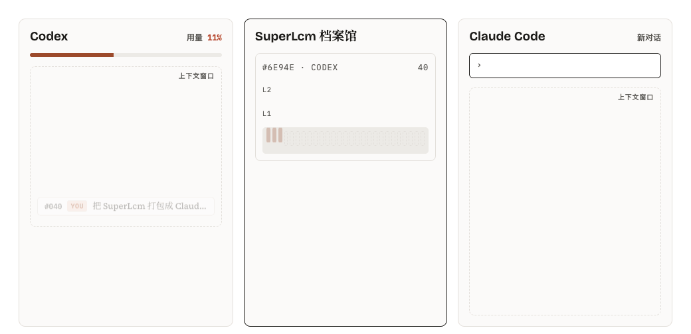
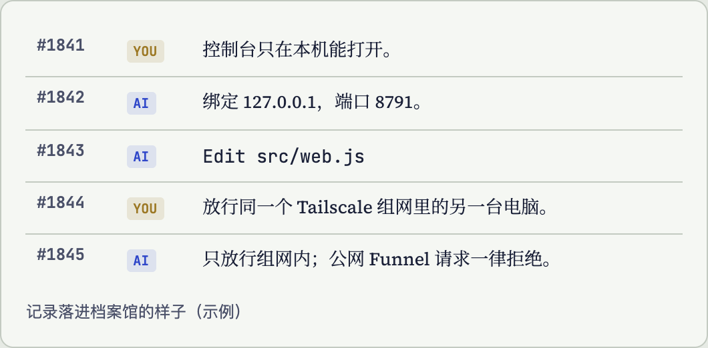
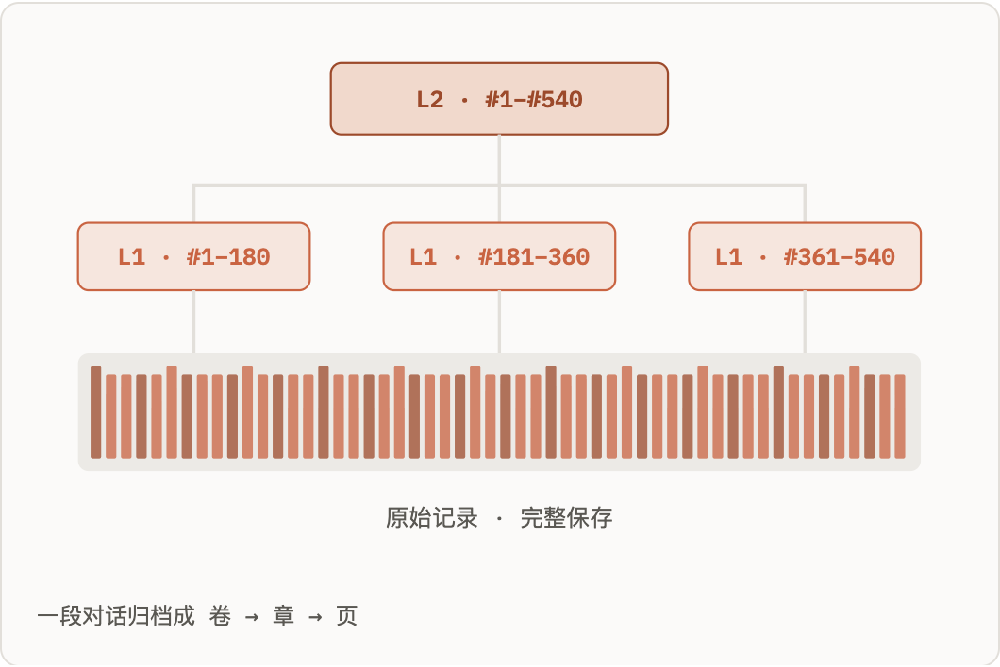
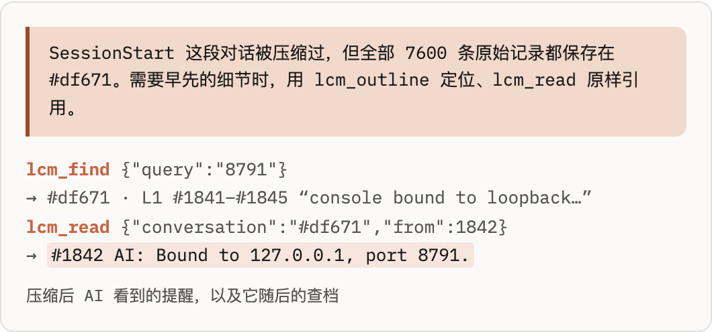

<h1 align="center">SuperLcm</h1>

<b>四种载体，一座本地对话档案馆。</b> 原文完整保存，摘要分层整理，换个载体继续任务。

<a href="README.md">English</a> · <b>中文</b>

SuperLcm 让 **Claude Code、Codex、Pi 和 dsh harness** 共用一座存放在你电脑上的对话档案馆。原始记录完整保留，分层摘要帮助你快速找到要紧的部分。换个工具时，一句话就能接续任务；早先的细节随时按编号查原文。

本文介绍当前 `main` 分支。后台分支改造尚未发布为 npm 安装包，目前可[从源码运行](#从源码运行)。旧版变更见[更新记录](CHANGELOG.md)。

## 四种载体，一座档案馆

| 载体 | 原文存档、分层摘要、跨载体接续 | 压缩接入 | 怎么接入 |
|---|---|---|---|
| Claude Code | 支持 | 默认工具自身压缩；SuperLcm 接管可选 | Claude 插件或控制台 |
| Codex | 支持 | 工具自身压缩 | 控制台：查档工具和记录钩子 |
| Pi | 支持 | 默认工具自身压缩；SuperLcm 接管可选 | 控制台：自动加载的扩展 |
| dsh harness | 支持 | 默认工具自身压缩；SuperLcm 接管可选 | 控制台：全局接入，默认主模型后台分支 |

四种载体默认使用**主模型后台分支**：沿用当前对话模型和账号，在后台一次返回分块、父摘要和接续根节点。已明确配置的独立 API 和关闭状态保留。「对话模型自己写」及其两个摘要写入工具已移除。

控制台导航为 **对话 → 工具 → 压缩 → 设置**。摘要方式放在工具卡片，“压缩”页统一设置 Claude Code、Pi 和 dsh 的比例。摘要始终提前10个百分点准备：50%替换则40%准备，默认80%/70%。开启“允许其他模型”，可从对应工具的原生模型目录选择后台模型，聊天模型不变。已知容量达到约70%后后台准备；Pi 和 dsh 默认约80%只安装已准备的根摘要，最近和后来追加的原文保留。Codex 继续由宿主压缩。Claude 新配置使用原生容量百分比，旧绝对门槛在保存新比例前保持兼容；容量未知时不盲目自动调用模型。

默认每段约20,000个估算 token、每层四个子节点，正常准备时一次模型响应返回整棵树，核验原文、完整性和预算后一起保存。实际缓存读写以供应商回执为准。详见[架构与验证边界](docs/MAIN-FORK.md)。

先从 [安装包说明](docs/RELEASE.md) 安装，运行 `superlcm web`，在「工具」页选择工具即可。Claude Code 用户也可 [安装 Claude 插件](#安装成-claude-插件)，用 `/superlcm:console` 打开控制台。DSH 插件已内置于 SuperLcm，无需单独下载或安装 dsh-superlcm。完成全局接入后重新加载 dsh harness，即可在其「插件」列表看到 SuperLcm。后台摘要默认沿用当前对话模型和账号，独立摘要 API 作为高级选项保留。见 [接入说明](docs/DSH.md)。

0.5.11 起，后台摘要、Claude 和 DSH 的压缩摘要统一保留决策变更、理由、授权边界、工具失败及历史来源。旧摘要不会自动重算；原文仍是查证依据。见 [摘要语义规则与验收边界](docs/SUMMARY-SEMANTICS-0.5.11.md)。

## 把整段对话连同摘要，整个搬进另一个工具

<picture><source media="(prefers-color-scheme: dark)" srcset="docs/images/handoff-zh-dark.gif"></picture>

- **停在哪，就从哪接着干。** 额度用完、被限速，或者想让另一个模型看看，到另一个工具里说一句 `通过 SuperLcm 接续对话 #6e94e`，任务就接着往下走。
- **不用复述，不用整段粘贴。** `lcm_continue` 交过去的是分层目录加最近几条原文，新的 AI 一开局上下文就小而准，不是把整份聊天记录硬塞进去。
- **每个细节随时一查就有。** 整段对话都在档案馆里。早先的某个决定要紧时，新的 AI 用 `lcm_read` 按编号把那条原文一字不差地读出来。
- **任意方向，来回都行。** Claude Code、Codex、Pi、dsh harness 读写的是同一座档案馆，接着干的内容也会存进去，以后可以用同样的办法再交还回去。

## 一次后台分支，一次写完整棵树

Pi 和 dsh 使用默认80%接管设置时，流程如下：

Claude Code、Pi 和 DSH 的压缩页统一为接管开关、压缩比例、后台摘要模型和最近原文保留。原文保留可选 20K / 40K / 80K 或自定义 5K–200K；上下文较小时目标量自动缩小至当前对话的一半，完整轮次和工具组仍会保留。摘要粒度和层级合并数量只在“设置”里统一配置，DSH 运行时也读取这份设置；保留量或粒度变化后，旧的准备结果会失效。开关和预设点击即保存，自定义数值在输入框旁保存；模型另行保存，页面末尾没有整页保存按钮。

正常准备点之前持续归档原文。达到准备点后，插件固定一段安全的旧原文，安排所有分块与层级，一次请求让模型把整棵树写齐。**20K token 是原文分块粒度，每块不需要单独调用一次模型。** 准备期间主对话继续，替换时直接读取已保存结果。

Pi 和 DSH 跨轮复用已保存分块，按设置的数量合并相邻同粒度分块。后台只写新分块、需要合并的父摘要和当前接续总览；旧块保持原样，总览单独保存，避免每次替换都增加一个历史层级。旧总览仍可检索。

“一次响应”指一次成功的准备任务。后续有新的可整理范围时可以另起任务，失败或失效的任务可以重试。容量保护也可能提前准备。关闭接管时，摘要供查档使用，上下文由宿主管理。明确选择独立 API 高级模式时，仍使用该模式的后台分批流程。实际缓存读写以供应商回执为准。

Pi 和 DSH 接管使用主模型分支时，连续 10 分钟没有有效输出才会中止本次摘要；模型持续输出文本或推理时可以继续完成。失败后后台自动重试，间隔逐步增加、最长 5 分钟，总重试时长和次数不设上限。达到容量保护线时，当前请求保留并暂停，等摘要核验通过后替换。用户停止、更改设置或模型、原文失效、引擎关闭都会取消旧任务；无效摘要和迟到结果不会替换原文。Pi 捕获的前缀或模型不再匹配时，等待新的供应商请求后再准备。

Pi 和 DSH 压缩比例按模型总上下文窗口计算。默认 500K 窗口在 350K 准备、400K 替换，输出预留不再提前这两个门槛。接管期间单独限制实际输出上限：Pi 只调整发出的请求，模型配置不变；DSH 通过宿主请求配置入口限制，关闭接管时恢复原配置。到容量保护线仍在重试时，当前请求保留并等待。新增的超大输入或工具仍会触发容量保护。

Pi 提示词中的整树大小是规划目标。完整摘要树在实际请求输出额度内可以略超目标，替换所用的根摘要仍单独检查容量。重试开始后，状态继续保留上一轮失败原因。

Pi 重开接近容量上限的会话时先寻找已准备结果；需要新请求时，先捕获再暂停发送，让后台分支继续准备。整段对话放不下摘要指令时，可以从选中的较早历史边界分支，完整消息和未摘要尾部仍保留。容量恢复时最近原文的保留目标可以缩小。冷恢复替换成功后，再提交“继续”恢复已保存的请求。

## Claude Code 的可选压缩接管

从「压缩」页启用 Claude Code 接管时，默认按模型窗口的80%替换，并提前10个百分点准备。旧绝对 token 设置（包括 CLI 默认的300K）在保存新比例前继续生效。最近40K token 默认原样保留，完整原文始终可查。分支模式在替换入口只读取现成摘要，覆盖或边界不满足要求时交回 Claude 原生压缩。

接管默认关闭。打开「压缩 → Claude Code」启用。Claude 插件提供记录钩子、四个查档工具、压缩接管模块和 `/superlcm:console` 控制台入口。模块需要 Claude Code 2.1.286+，本机能力由控制台显示。

## 压缩缩短上下文，SuperLcm 保存原文

摘要是档案的目录。很久之后再问部署端口或某个决定，AI 可以用 `lcm_find` 搜索、用 `lcm_outline` 翻目录，再用 `lcm_read` 读回原话。摘要遗漏了某个细节，原文仍在档案中。

## 怎么做到的

**每一轮对话，说完就存。** 你的消息、AI 的回复和它调用的工具，从各载体自己的对话文件或原始事件中归档。原始文件或完整事件记录保留在本机，查阅时会核对来源。每条记录都有编号，以后能像账本页码一样被引用。档案留在你电脑上，生成摘要时使用你选择的模型。

<picture><source media="(prefers-color-scheme: dark)" srcset="docs/images/fig1-zh-dark.png"></picture>

**摘要分层，每一层都指回原文页码。** 插件把旧原文按约20,000个估算 token 的粒度分块，再按默认四个子节点安排父层。分块摘要和所有父层在同一次后台响应中生成。树顶读起来就像整段对话的目录，每一条都带着它来自哪些记录的编号。摘要帮助定位历史，关键结论和精确细节按来源编号查回原文。

<picture><source media="(prefers-color-scheme: dark)" srcset="docs/images/fig2-zh-dark.png"></picture>

**AI 先读原文，再回答。** 每次压缩之后，AI 会收到一句提醒，告诉它完整记录存在哪。它的查档工具能搜摘要和原文（中英文都行）、翻目录、按编号读原文，读出来的内容会和原始对话文件核对。

<picture><source media="(prefers-color-scheme: dark)" srcset="docs/images/fig3-zh-dark.png"></picture>

## 摘要谁来写

默认使用**主模型后台分支**。摘要生成与压缩接管是两项独立功能：Claude、Codex、Pi 和 dsh 都能后台写摘要；Claude、Pi 和 dsh 可另外开启接管。独立 API 模型属于高级选项，也可关闭后台摘要。旧的聊天模型摘要任务和提交入口已删除。

Pi 与 dsh 平时约70%提前准备整棵树，约80%直接使用已完成的根摘要。期间追加的消息和当前完整用户请求保持原文。容量不足但摘要尚未就绪时暂停下一次模型发送，原文保留；不会在80%的替换入口临时生成。详见 [Pi 接入](docs/PI-COMPACTION.md) 与 [统一后台分支](docs/MAIN-FORK.md)。

DSH 历史对话仍可导入，包含完整工具记录，不调用模型，重复导入去重。取消接入会停止自动归档和摘要，保留全部档案；已有会话重新加载后生效。

## 压缩 vs 档案馆

| | 普通压缩 | SuperLcm |
|---|---|---|
| 原话 | 压缩后 AI 就够不着了 | 完整保存，按编号随时读 |
| 摘要形态 | 一段扁平摘要，每压一次更短 | 像书一样分层，每层指回页码 |
| 300 轮前的一个细节 | 摘要碰巧留下了才有 | 搜得到，原样引用 |
| 上下文满了（Claude Code，可选接管） | 停下来等模型总结 | 摘要就绪时一次替换；否则由 Claude 原生压缩 |
| 换个工具接着干 | 从头再讲一遍 | 一句话，带着目录和最近原文 |
| 存在哪 | — | 你电脑上的一个文件 |

## 安装成 Claude 插件

在 Claude Code 里：

    /plugin marketplace add yu381792/superlcm
    /plugin install superlcm@superlcm

插件自带上面列出的全部功能；要用接管压缩，打开控制台在「工具 → 可选压缩接管 → Claude Code」打开开关。`/superlcm:console` 打开控制台，在那里把 Codex、Pi、dsh harness 接进同一座档案馆。能用的地方是 Claude 能启动本机程序的地方：Claude Code，以及在你自己电脑上运行的 Cowork；claude.ai 网页版和手机聊天用不了。需要 PATH 里有 Node.js 22.16 或更新版本；如果默认的 `node` 太旧，而电脑上装有更新的版本，会自动换用新的。

插件更新会替换插件文件夹，所以从插件控制台接入的其他工具会连到 SuperLcm 文件夹里一个固定的入口文件（`~/.superlcm-claude/superlcm.js`），它会跟着插件更新走。如果之前已经从控制台接入过 Claude Code，启用插件后设置里的旧钩子会自动静默；控制台的 Claude 卡片可以一键清掉旧钩子和旧的 `superlcm` MCP 条目（先备份）。安装和更新插件也在这张卡片上。

## 从源码运行

    node src/cli.js web

打开 `http://127.0.0.1:8791/`（不用登录，只在本机监听），在“工具”页选工具并确认即可。更多说明见英文文档：[安装、安全与限制](docs/SETUP.md) · [控制台说明](docs/CONSOLE.md)。

## 许可

[MIT](LICENSE)，版权所有 2026 ygc381792 及贡献者。可以自由使用、修改和再发布（包括商用），保留版权声明即可。本项目由个人维护、刻意保持精简：欢迎提 [issue](https://github.com/yu381792/superlcm/issues) 反馈问题和需求，但不保证每条都采纳，一般不合并代码请求（PR）。

Claude、Claude Code、Codex、Pi 的名称和标志归各自所有者，这里只用来说明兼容的工具；SuperLcm 是独立项目，与它们没有隶属或背书关系。

摘要语言和指令隔离修复见 [新版说明](docs/SUMMARY-QUALITY-0.5.24.md)。

DSH 统一使用主包内置的插件接入，安装与旧独立插件迁移见 [DSH 接入说明](docs/DSH.md)。

Claude 接管的真实宿主验证与社区修复见 [Claude 接管可靠性说明](docs/CLAUDE-RELIABILITY.md)。

主动审查与发布前故障验证见 [发布验证说明](docs/RELEASE-VERIFICATION.md)。发布者运行 `npm run verify:release`，包含实际安装包、运行时和失败场景；两版共用修复在发布前核对一致。

可靠性测试：`npm run test:reliability`；完整发布检查：`npm run verify:release`。覆盖范围见 [连续使用与故障恢复测试台](docs/RELIABILITY-LAB.md)。
